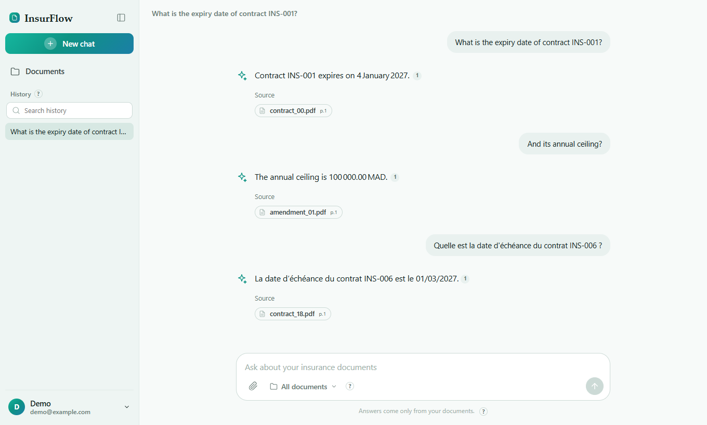
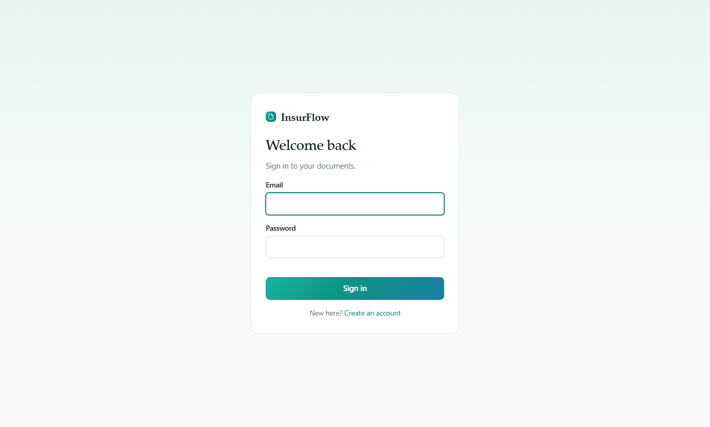
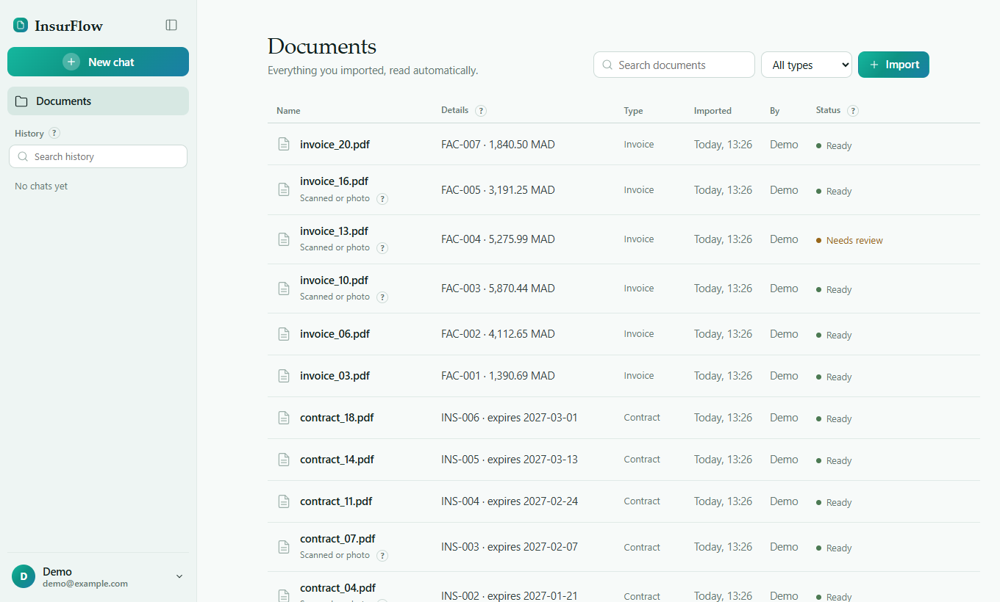

# InsurFlow — Intelligent Insurance Document Assistant

<p align="center">
  
</p>

<p align="center">
  **A local-first assistant for insurance documents, combining OCR, information extraction, hybrid search and question answering.**
</p>

<p align="center">
  
  
  
  
  
</p>

---

## Overview

InsurFlow processes insurance documents (contracts, amendments, claims and invoices) using OCR and information extraction. Users can upload PDFs or images, retrieve extracted information and ask questions in English or French.

Answers include source passages and page references. If the documents do not contain sufficient evidence, the system refuses to answer.

**Main features**
- PDF and image processing with OCR.
- Extraction and validation of policy numbers, dates, amounts and guarantees.
- Cross-document consistency checks.
- Hybrid keyword and vector search.
- Question answering with source references.
- Conversation history and per-user semantic memory.

> Portfolio project tested on synthetic documents. Not intended for real customer data or production use.

## Application Preview

| Sign in | Document Management |
|:---:|:---:|
|  |  |

**Question Answering**


## Technology Stack

| Layer | Technologies |
|---|---|
| Language & Web | Python 3.11+, Flask, Waitress, HTML, CSS, JavaScript |
| Database | PostgreSQL 15, pgvector, SQLAlchemy, SQLite fallback |
| OCR & PDF | PyMuPDF, RapidOCR |
| Information Extraction | Regex-based extraction, bilingual document layouts, optional LLM fallback |
| Search & Retrieval | PostgreSQL Full-Text Search, pgvector HNSW, FastEmbed, all-MiniLM-L6-v2 |
| LLM Integration | Groq (openai/gpt-oss-20b), Gemini — optional external APIs |
| Memory | Conversation trimming, rolling summaries, per-user semantic memory |
| Testing & Quality | pytest, Ruff |

## Architecture & Workflow

### 1. Document Ingestion
- File validation and duplicate detection.
- Digital text extraction or page-level OCR.
- Document classification.
- Key information extraction and validation.
- Text chunking and embedding generation.

### 2. Retrieval & Question Answering
- Hybrid retrieval using keyword and vector search.
- Retrieval restricted to the authenticated user's documents.
- Programmatic evidence sufficiency checks.
- Answer generation with source passages and page references.
- Refusal when supporting evidence is insufficient.

### 3. Conversation Memory
- Recent conversation turns and rolling summaries.
- Per-user semantic memory.
- Memory management through the account interface.

Conversation memory provides context only. It is never treated as evidence for document-based answers.

For implementation details:
- [System Architecture](docs/architecture.md)
- [Security Design](docs/security.md)

## Getting Started

### Prerequisites

- Python 3.11+
- Git
- Docker and Docker Compose (for PostgreSQL)

### Installation

```bash
git clone https://github.com/khadijaerraja/InsurFlow_ocr.git
cd InsurFlow_ocr

pip install -r requirements.txt
```

Create the environment file:

```bash
cp .env.example .env
```

Configure `.env`:

- Set `POSTGRES_PASSWORD` for PostgreSQL.
- Set `SECRET_KEY` using:

```bash
python -c "import secrets; print(secrets.token_hex(32))"
```

- Change `POSTGRES_PORT` if port `5432` is already in use.
- Optionally set `GROQ_API_KEY` or `GEMINI_API_KEY` for external LLM integration.

### Start the Application

Start PostgreSQL:

```bash
docker compose up -d
```

Initialize the database and create a user:

```bash
python -m src.cli init-db
python -m src.cli create-user you@example.com --name "Your Name"
```

Start the web application:

```bash
python -m src.web
```

Open [http://127.0.0.1:8000](http://127.0.0.1:8000), sign in, go to **Documents**, and select **Load sample documents**.

The sample dataset contains 21 synthetic documents in English and French, including 7 scanned documents. Initial processing takes approximately 40 seconds.

### SQLite Fallback

Docker is optional. When PostgreSQL is not configured, the application can use a local SQLite database.

The SQLite fallback does not provide PostgreSQL-specific pgvector functionality.

### Additional CLI Commands

```bash
# Load sample documents
python -m src.cli load-samples you@example.com

# Ask a question from the terminal
python -m src.cli ask you@example.com "What is covered under dental care?"

# Run retrieval and refusal evaluation
python -m src.evaluation --user you@example.com

# Run tests
python -m pytest -q
```

## Evaluation

Tests were conducted on synthetic insurance documents using PostgreSQL and the configured embedding model.

### Retrieval & Answer Quality

| Metric | Result |
|---|---:|
| Hybrid retrieval hit rate | 100% |
| Mean Reciprocal Rank (MRR) | 0.98 |
| Evidence recall | 1.00 |
| Correct refusals on unanswerable questions | 7/7 |

### RAG Evaluation

RAGAS evaluation on 16 answers, using `gpt-oss-120b` as the evaluation judge.

| Metric | Score |
|---|---:|
| Faithfulness | 1.00 |
| Context Recall | 1.00 |

### OCR Accuracy

| Test condition | Character Error Rate (CER) | Field Accuracy |
|---|---:|---:|
| Clean scans (PNG and JPEG) | 0.4–1.5% | 99–100% |
| Tilted pages (3° rotation) | 26% | ~59% |
| After deskew (tested case) | 0.5% | — |

The main OCR issue was line grouping on rotated pages. Applying deskew before OCR reduced the character error rate from 26% to 0.5% in the tested case.

### Agent Safety

| Metric | Result |
|---|---:|
| Correct refusals | 12/12 |
| False refusals | 0/43 |
| Prompt injection attempts resisted | 2/2 |

Prompt injection testing covered only two attempts and does not establish comprehensive protection.

**Automated tests:** 132 passing, covering SQLite and PostgreSQL.

Full protocol, per-format results and evaluation details: [Evaluation Results](docs/evaluation-results.md).

The dataset and test samples are limited and synthetic. These results should not be interpreted as production performance or generalization to real insurance documents.

## Current Limitations

- **Synthetic data:** Extraction rules are designed around the included document layouts.
- **Language mismatch:** The default embedding model is English-oriented. Cross-language retrieval may be limited unless a contract number or another strong keyword is provided.
- **Database migrations:** No migration framework is currently integrated.
- **Ingestion:** Document ingestion uses a single worker.
- **Authentication:** Login throttling is stored in process memory.
- **Prompt injection:** Protection is partial. When an external LLM API is enabled, retrieved excerpts are sent to that provider. Do not upload real personal or confidential information.
- **Amendment conflicts:** The application does not yet resolve which contractual clause takes precedence when an amendment conflicts with the original contract.

## Future Improvements

- **Multilingual retrieval:** Multilingual embeddings, cross-language evaluation and Arabic support.
- **Amendment-aware reasoning:** Identify the currently applicable contractual clauses.
- **Document review:** Correct extracted fields and rerun validation.
- **Advanced extraction:** Support more document layouts and table-aware extraction.
- **Security:** Password reset, email verification, two-factor authentication, shared rate limiting and audit exports.
- **Access control:** Role-based permissions and shared team libraries.
- **Multi-tenancy:** Organisation-level isolation and resource quotas.
- **Deployment:** Alembic migrations, background ingestion jobs, CI/CD and monitoring.

## License

This project is distributed under the [MIT License](LICENSE).
